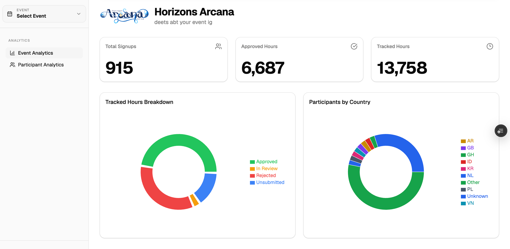
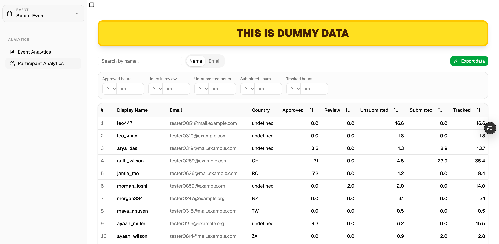

Hi there!

This is a small tool I built to sort out the participant data of a hackathon i organised a couple months back.

It has two pages, first one shows all the metrics i.e. number of signups, total hours of work submitted, countries where the signups originated from etc. etc. 

This page is just to visualise the data in charts.

The second page shows all the participants with all the data. You can sort them out in ascending and descennding order. Also you can filter them out on the basis of values through the filters at the top.

its deployed here with dummy data for testing: https://horizons-events-dashboard-8fi8.vercel.app/